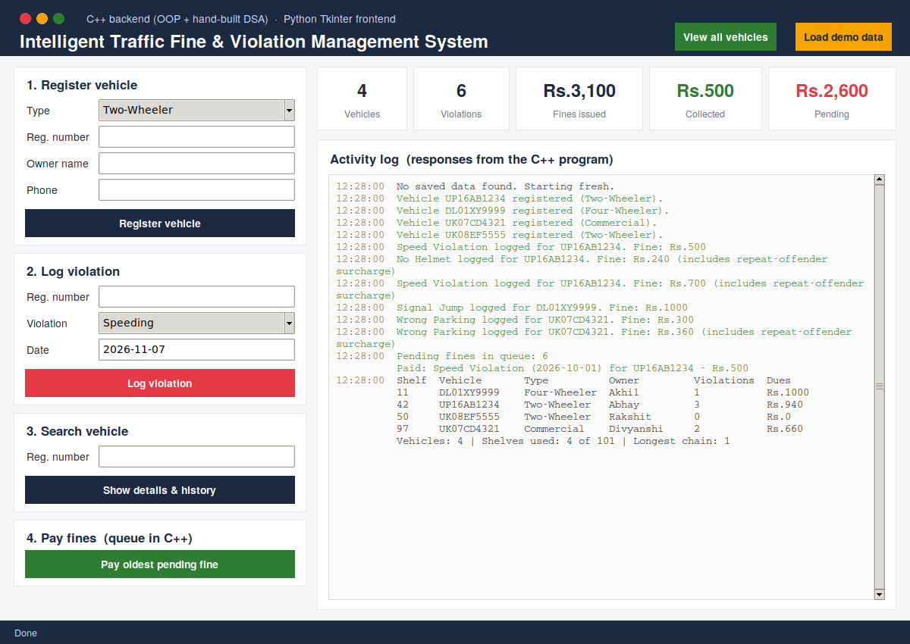

<div align="center">

# 🚦 Intelligent Traffic Fine & Violation Management System

**A traffic-office system in C++ built on hand-written data structures, with a Python Tkinter dashboard on top.**


*PBL Project (Data Structures + OOP with C++) · B.Tech CSE · Graphic Era Hill University · Team **SYNAPSE***



</div>

---

## 📑 Table of Contents

- [Overview](#-overview)
- [Features](#-features)
- [Architecture](#-architecture)
- [Data Structures](#-data-structures)
- [OOP Concepts](#-oop-concepts)
- [Fine Calculation](#-fine-calculation)
- [Project Structure](#-project-structure)
- [Getting Started](#-getting-started)
- [Usage](#-usage)
- [Saved Data Format](#-saved-data-format)
- [Testing](#-testing)
- [Known Limitations](#-known-limitations)
- [Future Improvements](#-future-improvements)
- [Team SYNAPSE](#-team-synapse)

---

## 📌 Overview

This project manages the everyday work of a traffic office: registering vehicles, recording violations, calculating fines, collecting payments and reporting totals.

Every core structure is **written from scratch**, with no STL containers (`vector`, `map`, `queue`, etc.). A hash table, a linked list and a queue each solve one real problem in the system. Around them sits a clean OOP design with abstraction, inheritance, polymorphism and custom exceptions.

The C++ program is a menu-driven console application. A Python Tkinter window launches the same program and talks to it through pipes, so the project can be demonstrated visually **without rewriting any logic in Python**.

## ✨ Features

- 🚗 **Vehicle registration** for two-wheelers, four-wheelers and commercial vehicles, each linked to an owner. Registration numbers are validated and duplicates are rejected.
- 🚨 **Violation logging** for speeding, signal jump, no helmet and wrong parking. Each type calculates its own fine.
- 📈 **Automatic repeat-offender surcharge** based on a vehicle's earlier violations.
- 🔎 **Fast vehicle search** by registration number, showing full details and violation history.
- 💳 **Oldest-first payment** using a FIFO queue.
- 📊 **Summary report** of fines issued, collected and pending.
- 💾 **File persistence**: records are saved on exit and loaded on the next start.
- 🖥️ **Tkinter dashboard** with a *Load demo data* button for quick demonstrations.

## 🏗️ Architecture


The Python window starts the compiled C++ program once and keeps it running. It types the menu choice and inputs, reads what the program prints, strips the menu text and shows the result.

The C++ code is split into modules, one per team member. Each header includes the one before it:

```
Exceptions.h + Violation.h  →  Vehicle.h  →  Records.h  →  Payment.h  →  main.cpp
```

## 🧠 Data Structures

All structures are implemented by hand.

| Structure | File | Used for | Complexity |
|---|---|---|---|
| **Hash table** with separate chaining (101 buckets, polynomial rolling hash) | `Vehicle.h` | Finding a vehicle by registration number | O(1) average |
| **Singly linked list** | `Violation.h` | Each vehicle's violation history (newest first) | O(1) insert at head |
| **Queue (FIFO)**, linked-list based | `Payment.h` | Paying pending fines, oldest first | O(1) enqueue / dequeue |
| **Insertion sort** | `Payment.h` | Ordering pending fines by date before queueing | O(n²) |

## 🧩 OOP Concepts

| Concept | Where it is used |
|---|---|
| **Abstraction** | Abstract classes `Violation` and `Vehicle` with pure virtual functions |
| **Inheritance** | `SpeedViolation`, `SignalJump`, `NoHelmet`, `WrongParking` extend `Violation`; `TwoWheeler`, `FourWheeler`, `CommercialVehicle` extend `Vehicle` |
| **Polymorphism** | `calculateFine()` is called through a `Violation*` and the correct fine runs |
| **Encapsulation** | Private data in `Owner`, `HashTable` and `PendingQueue`, accessed through member functions |
| **Factory functions** | `createVehicle()` and `createViolation()` build the right subclass from a type code |
| **Exception handling** | Three custom exceptions, all caught in one place in `main.cpp` |
| **Constructors / destructors** | Every class that owns memory frees it; copying is disabled where it would cause a double delete |
| **File handling** | `ofstream` / `ifstream` save and load `records.txt` |

## 💰 Fine Calculation

```
Final fine = base fine + 20% of the base fine × (number of earlier violations of that vehicle)
```

| Violation | Base fine |
|---|---|
| Speeding | Rs. 500 |
| Signal Jump | Rs. 1000 |
| No Helmet | Rs. 200 |
| Wrong Parking | Rs. 300 |

**Example (Speeding, base Rs. 500):**

| Earlier violations | Final fine |
|---|---|
| 0 | Rs. 500 |
| 1 | Rs. 600 |
| 2 | Rs. 700 |

## 📁 Project Structure

```
.
├── src/                     C++ source (the whole backend)
│   ├── Exceptions.h         custom exceptions + registration-number checks    (Divyanshi)
│   ├── Violation.h          violation classes + linked list                   (Rakshit)
│   ├── Vehicle.h            vehicle classes + hash table + registration       (Abhay)
│   ├── Records.h            find a vehicle, log a violation                   (Divyanshi)
│   ├── Payment.h            pending queue, save/load, report                  (Akhil)
│   └── main.cpp             menu and integration                              (Akhil)
├── gui/
│   ├── gui.py               Tkinter window
│   └── backend.py           bridge that runs the C++ program through pipes
├── docs/
│   └── images/              screenshot and architecture diagram
├── Makefile
├── .gitignore
└── README.md
```

## 🚀 Getting Started

### Requirements

- A C++ compiler with C++11 support (`g++`)
- *(Optional, for the window)* Python 3 with `tkinter`. On Ubuntu: `sudo apt install python3-tk`

### Clone

```bash
git clone https://github.com/<your-username>/<your-repo>.git
cd <your-repo>
```

### Console version

```bash
make run
```

Without `make`:

```bash
mkdir build
g++ -std=c++11 -Wall -Wextra src/main.cpp -o build/traffic
./build/traffic            # Windows: build\traffic.exe
```

> Run from the repository root so `records.txt` is saved there.

### Python window

```bash
make gui                   # or: python3 gui/gui.py   (Windows: python gui\gui.py)
```

The C++ program is compiled automatically on the first run and recompiled whenever a source file changes. Use **Load demo data** to fill the system with sample vehicles and violations. Close the window with the **X** button so the records are saved.

### Clean up

```bash
make clean                 # removes build/ and records.txt
```

## 🕹️ Usage

### Menu

| Choice | Action |
|:---:|---|
| `1` | Register vehicle |
| `2` | Log violation |
| `3` | Search vehicle (details and history) |
| `4` | Pay oldest pending fine |
| `5` | Summary report |
| `0` | Save and exit |

> Owner names and phone numbers must be **one word**. Use `_` instead of spaces.

### Example session

```
Vehicle UP16AB1234 registered (Two-Wheeler).
Speed Violation logged for UP16AB1234. Fine: Rs.500
No Helmet logged for UP16AB1234. Fine: Rs.240 (includes repeat-offender surcharge)
Paid: Speed Violation (2026-10-01) for UP16AB1234 - Rs.500
========== SUMMARY REPORT ==========
Vehicles registered : 1
Violations issued   : 2
Total fines issued  : Rs.740
Collected (paid)    : Rs.500
Pending (unpaid)    : Rs.240
====================================
```

## 💾 Saved Data Format

`records.txt` is plain text. The first line is the number of vehicles. Each vehicle takes one line, followed by one line per violation.

```
2
2 DL01XY9999 Akhil 8888888888 1      <- vehicle type, plate, owner, phone, violation count
2 2026-10-05 1000 0                  <- violation type, date, final fine, paid (1) / unpaid (0)
1 UP16AB1234 Abhay 9999999999 3
1 2026-10-07 700 0
3 2026-10-03 240 1
1 2026-10-01 500 1
```

## ✅ Testing

Verified on the final code:

- Builds with `g++ -std=c++11 -Wall -Wextra` with no errors or warnings.
- AddressSanitizer and UndefinedBehaviorSanitizer report no leaks or errors in full sessions, including save and reload.
- Scripted tests of the modules and the menu: registration (valid, duplicate, too short, bad type), fine and surcharge amounts, hash-table search, collision and removal, pay-queue order, save and reload, invalid menu input.
- The Python window was run end to end against the C++ program (register, log, search, pay, dashboard).

## ⚠️ Known Limitations

- A `records.txt` that is damaged part-way can load only some vehicles and then be overwritten on exit. A backup copy and a clearer message are planned.
- The C++ code does not validate the date format. The Python window does.
- Single user, single session. No networking and no real payment gateway: paying only marks a fine as paid.
- Owner names and phone numbers are limited to one word.

## 🔮 Future Improvements

- Backup of `records.txt` before overwriting, with a clear error on corrupt files.
- Date-format validation in the C++ core.
- Support for multi-word names and phone-number validation.
- A "most fined vehicles" leaderboard.
- Online payment integration and a multi-user mode.

## 👥 Team SYNAPSE

| Member | Module | Files | Main focus |
|---|---|---|---|
| **Abhay** | Vehicle & Owner | `Vehicle.h` | Hash table |
| **Rakshit** (team lead) | Violation & Fine | `Violation.h` | Linked list |
| **Divyanshi** | Record Management | `Exceptions.h`, `Records.h` | Exception handling |
| **Akhil** | Payment, Persistence & Reporting | `Payment.h`, `main.cpp` | Queue and file handling |

The Python window is a shared part of the project.

---

<div align="center">

Developed as a Problem-Based Learning (PBL) project to apply **C++, OOP and DSA** to a real-world traffic management problem.

</div>
